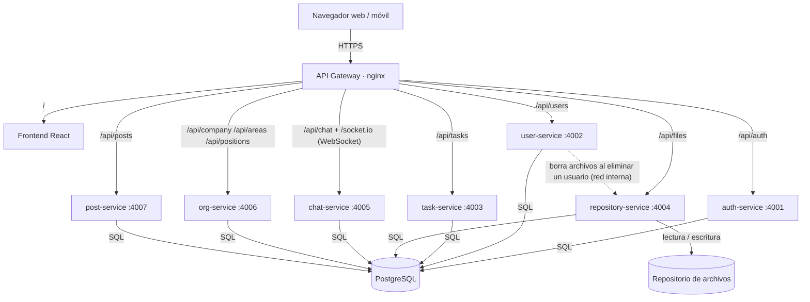

# Tareas, comunicación interna y repositorio organizacional

Aplicación web para **gestión de tareas, comunicación interna en tiempo real, publicaciones, estructura organizacional (áreas, cargos, organigrama, directorio) y centralización de documentos**, construida con microservicios y desplegable 100 % con Docker. La interfaz sigue las plantillas de diseño de Figma y la marca (nombre, eslogan, logo, colores, foto de inicio de sesión) es configurable.

| Capa | Tecnología |
|---|---|
| Frontend | React 19 (JavaScript) + Vite + Tailwind CSS 4 |
| API Gateway | nginx (único punto de entrada) |
| Backend | 7 microservicios Node.js 20 + Express (JavaScript) |
| Tiempo real | Socket.IO (WebSocket) |
| Base de datos | PostgreSQL 16 (imagen oficial) |
| Archivos | Volumen Docker `repo-data` gestionado por el servicio de repositorio |

---

## 1. Arquitectura



Decisiones de diseño a tener en cuenta:

* **El WebSocket del chat también pasa por el gateway** (`/socket.io`), no se expone el puerto del chat. Así el sistema tiene un único puerto público y HTTPS/WSS funcionan con un solo certificado.
* **Los permisos se leen de la base de datos en cada petición**: desactivar a una persona o quitarle un permiso surte efecto de inmediato, sin esperar a que expire su sesión.
* Los indicadores (`/stats`) los calcula cada servicio sobre sus propios datos.

### Servicios

| Servicio | Puerto interno | Responsabilidad |
|---|---|---|
| `gateway` | 80 / 443 | Enruta `/api/*`, `/socket.io` y el frontend; cabeceras de seguridad; límite de peticiones en el login; oculta `/internal` |
| `frontend` | 80 (dev: 5173) | SPA React: interfaz de **usuario** (`/`) y de **administración** (`/admin/...`) |
| `auth-service` | 4001 | Login (por usuario o documento), sesión (`/me`), cambio de contraseña, emisión de JWT |
| `user-service` | 4002 | Personas: alta/edición, nivel y permisos, activar/desactivar, restablecer contraseña, directorio, perfil propio |
| `task-service` | 4003 | Tareas asignadas, autoasignadas y solicitudes (según la jerarquía de áreas y cargos), completar con nota y adjunto, notificaciones |
| `repository-service` | 4004 | Repositorio por carpetas (empresa → áreas → cargos), fotos de perfil, portadas y adjuntos; vista previa, descarga, cuotas |
| `chat-service` | 4005 | Mensajería 1 a 1 en tiempo real (WebSocket), historial, no leídos, presencia |
| `org-service` | 4006 | Datos de la empresa (marca), áreas (jerarquía «Depende de», responsable) y cargos («Reporta a») |
| `post-service` | 4007 | Publicaciones con audiencia por área, me gusta y comentarios |
| `postgres` | 5432 (interno) | Base de datos |

Solo el **gateway** publica puertos en producción. PostgreSQL y los microservicios quedan en la red interna de Docker.

---

## 2. Requisitos

* Docker Engine 24+ y **Docker Compose v2** (`docker compose …`).
* Git (opcional) y `openssl` (para generar secretos).
* Producción: un servidor Linux con 1 vCPU / 1 GB de RAM como mínimo, y los puertos 80/443 abiertos.

---

## 3. Estructura del proyecto

```
.
├── docker-compose.yml          # PRODUCCIÓN
├── docker-compose.dev.yml      # DESARROLLO
├── .env.example                # plantilla de configuración  →  copiar a .env
├── db/init/01-schema.sql       # esquema de la base de datos
├── gateway/                    # configuración nginx (dev, prod, prod+HTTPS)
│   ├── nginx.dev.conf  nginx.prod.conf  nginx.prod.ssl.conf
│   └── snippets/               # rutas y cabeceras compartidas
├── services/
│   ├── Dockerfile              # genérico (targets: dev | prod)
│   ├── shared/                 # código común: BD, JWT, errores, app Express
│   └── auth-service/ user-service/ task-service/ repository-service/
│   └── chat-service/ org-service/ post-service/
├── frontend/                   # React + Vite + Tailwind
└── scripts/
    └── backup.sh               # respaldo de BD + archivos (producción)
```

---

## 4. Configuración (`.env`)

```bash
cp .env.example .env               # y edita los valores
```

| Variable | Descripción |
|---|---|
| `ADMIN_USER` / `ADMIN_PASSWORD` | **Credenciales del administrador.** `ADMIN_PASSWORD` es la contraseña inicial; el administrador puede luego cambiarla en la plataforma |
| `POSTGRES_DB` / `POSTGRES_USER` / `POSTGRES_PASSWORD` | Base de datos |
| `JWT_SECRET` | Firma de sesiones. Largo y aleatorio (`openssl rand -hex 32`) |
| `INTERNAL_API_KEY` | Llave de comunicación entre microservicios |
| `JWT_EXPIRES_IN` | Duración de la sesión (por defecto `8h`) |
| `LOGIN_RATE_LIMIT` | Intentos de login **fallidos** por IP cada 15 min (por defecto 30) |
| `COMPANY_NAME` / `COMPANY_SLOGAN` | Nombre y eslogan que se muestran en el login y el menú (el administrador puede cambiarlos luego en **Empresa**) |
| `COMPANY_PRIMARY_COLOR` / `COMPANY_ACCENT_COLOR` | Color principal (botones, acentos) y color suave de fondos, en formato `#RRGGBB` |
| `COMPANY_LOGIN_TEXT` | Texto bajo la tarjeta de inicio de sesión |
| `HELP_URL` | Enlace de «Centro de ayuda» |
| `DEVELOPER_NAME` / `DEVELOPER_URL` | Créditos «Desarrollado por» en el menú |
| `MAX_FILE_SIZE_MB` / `USER_QUOTA_MB` | Tamaño máximo por archivo (50) y cuota por usuario (500) |
| `BLOCKED_EXTENSIONS` | Extensiones no permitidas al subir (ejecutables por defecto) |
| `HTTP_PORT` / `HTTPS_PORT` | Puertos del gateway en **producción** (80 / 443) |
| `DEV_HTTP_PORT` | Puerto del gateway en **desarrollo** (8080) |
| `GATEWAY_CONF` | `nginx.prod.conf` (HTTP) o `nginx.prod.ssl.conf` (HTTPS) |

**Marca**: el logo por defecto es `frontend/public/img/logo.png` y la foto del login `frontend/public/img/login-bg.jpg`; reemplaza esos archivos (misma ruta) antes de construir para cambiarlos. Después, el administrador puede subir otro logo/foto, nombre, eslogan y colores desde **Administración → Empresa** sin reconstruir nada; eso se guarda en el volumen `company-data`.

> Si un valor contiene `$` o `#`, enciérralo entre comillas simples: `ADMIN_PASSWORD='Abc$123#'`.
> Nunca subas `.env` a un repositorio (ya está en `.gitignore`).

---

## 5. Desarrollo

```bash
docker compose -f docker-compose.dev.yml up --build
```

* Aplicación: **http://localhost:8080** (o `DEV_HTTP_PORT`).
* Cambios en `services/*/src`, `services/shared` y `frontend/src` se recargan automáticamente (nodemon / Vite HMR).
* PostgreSQL queda accesible solo desde tu máquina en `127.0.0.1:5432` (DBeaver, psql…).
* Si cambias un `package.json`: `docker compose -f docker-compose.dev.yml up --build`.

Comandos útiles:

```bash
docker compose -f docker-compose.dev.yml logs -f auth-service      # logs de un servicio
docker compose -f docker-compose.dev.yml down                      # detener (conserva datos)
docker compose -f docker-compose.dev.yml down -v                   # detener y BORRAR datos de desarrollo
```

---

## 6. Despliegue en producción

### 6.1 Preparar el servidor (Ubuntu/Debian)

```bash
curl -fsSL https://get.docker.com | sudo sh
sudo usermod -aG docker $USER && newgrp docker
sudo ufw allow 22/tcp && sudo ufw allow 80/tcp && sudo ufw allow 443/tcp && sudo ufw enable
```

### 6.2 Instalar y arrancar

```bash
git clone <tu-repositorio> plataforma && cd plataforma     # o copia la carpeta al servidor
cp .env.example .env                                       # y edita los valores (anota la clave del admin)
docker compose up -d --build
docker compose ps                                          # todos deben aparecer "healthy" / "running"
```

Abre `http://<ip-o-dominio>` e inicia sesión con `ADMIN_USER` / `ADMIN_PASSWORD`.

Verificación rápida:

```bash
curl -s http://localhost/gateway-health      # → ok
docker compose logs --tail=30 gateway auth-service
```

### 6.3 HTTPS (recomendado)

1. Apunta tu dominio (registro DNS **A**) a la IP del servidor.
2. Obtén el certificado con Let's Encrypt (el puerto 80 debe estar libre, así que hazlo **antes** de levantar el gateway, o detén `gateway` un momento):

   ```bash
   sudo apt install -y certbot
   sudo certbot certonly --standalone -d plataforma.midominio.com
   sudo cp /etc/letsencrypt/live/plataforma.midominio.com/fullchain.pem certs/fullchain.pem
   sudo cp /etc/letsencrypt/live/plataforma.midominio.com/privkey.pem   certs/privkey.pem
   sudo chmod 644 certs/*.pem
   ```
3. En `.env` pon `GATEWAY_CONF=nginx.prod.ssl.conf` y reinicia el gateway:

   ```bash
   docker compose up -d gateway
   ```
4. Renovación automática (los certificados duran 90 días). Crea `/etc/cron.d/plataforma-cert`:

   ```
   0 3 * * 1 root certbot renew --standalone --pre-hook "cd /ruta/plataforma && docker compose stop gateway" --post-hook "cp /etc/letsencrypt/live/plataforma.midominio.com/*.pem /ruta/plataforma/certs/ && cd /ruta/plataforma && docker compose start gateway"
   ```

*Prueba local con certificado autofirmado:*
`openssl req -x509 -nodes -newkey rsa:2048 -days 365 -subj "/CN=localhost" -keyout certs/privkey.pem -out certs/fullchain.pem`

Si ya tienes un balanceador o Cloudflare delante que termina el HTTPS, deja `nginx.prod.conf`: el gateway respeta `X-Forwarded-Proto`.

### 6.4 Actualizar a una nueva versión

```bash
git pull
docker compose up -d --build        # reconstruye solo lo que cambió; los datos se conservan
```

> **Migrar desde la versión anterior:** el esquema cambió por completo (usuarios con áreas/cargos, publicaciones, etc.). Si no necesitas conservar los datos, ejecuta `docker compose down -v` y vuelve a levantar. No hay script de migración de datos.

Si la nueva versión modifica el esquema SQL, aplícalo sobre la base existente (el script es idempotente):

```bash
docker compose exec -T postgres sh -c 'psql -U "$POSTGRES_USER" -d "$POSTGRES_DB"' < db/init/01-schema.sql
```

> `db/init/*.sql` solo se ejecuta automáticamente **la primera vez**, al crearse el volumen de PostgreSQL.

### 6.5 Respaldo y restauración

```bash
./scripts/backup.sh                 # → backups/AAAAmmdd-HHMMSS/{db.sql.gz, files.tar.gz, company.tar.gz}
```

Restaurar en un servidor limpio (después de `docker compose up -d`):

```bash
# base de datos
gunzip -c backups/<fecha>/db.sql.gz | docker compose exec -T postgres sh -c 'psql -U "$POSTGRES_USER" -d "$POSTGRES_DB"'
# archivos
docker compose run --rm --no-deps --user root -v "$PWD/backups/<fecha>:/backup" repository-service \
  sh -c 'tar xzf /backup/files.tar.gz -C /data && chown -R node:node /data'
# identidad de la empresa (logo / foto del login)
docker compose run --rm --no-deps --user root -v "$PWD/backups/<fecha>:/backup" org-service \
  sh -c 'mkdir -p /data/company && tar xzf /backup/company.tar.gz -C /data/company && chown -R node:node /data/company'
```

Programa el respaldo con cron (p. ej. diario a las 2 am): `0 2 * * * cd /ruta/plataforma && ./scripts/backup.sh`. Copia `backups/` fuera del servidor.

### 6.6 Cambiar la contraseña del administrador

Inicia sesión como administrador y ve a **Administración → Contraseña**. La nueva contraseña se guarda cifrada (bcrypt) en la tabla `admin_account`, tiene prioridad sobre `ADMIN_PASSWORD` del `.env` y cierra las demás sesiones abiertas del administrador.

`ADMIN_PASSWORD` del `.env` solo se usa mientras no se haya cambiado desde la plataforma. **Si olvidaste la contraseña**, borra la guardada para volver a la del `.env`:

```bash
docker compose exec postgres sh -c 'psql -U "$POSTGRES_USER" -d "$POSTGRES_DB" -c "DELETE FROM admin_account;"'
```

(Si además cambiaste `ADMIN_PASSWORD` en el `.env`, recrea el servicio con `docker compose up -d auth-service`; un simple `restart` no relee el `.env`.)

---

## 7. Cómo se usa

### Administrador (cuenta del `.env`)

Entra con `ADMIN_USER` / `ADMIN_PASSWORD` en la misma pantalla de login. Su menú de **Administración**:

* **Usuarios y permisos**: estadísticas, búsqueda por nombre/área/estado, **Crear usuario** (documento, nombres, apellidos, teléfono, fechas, área y cargo), **Editar permisos** (nivel Colaborador / Líder / Responsable / Administrador y permisos individuales: tareas, documentos, publicaciones, administración), activar/desactivar, restablecer contraseña y eliminar.
* **Áreas y cargos**: crear y editar áreas (con «Depende de» y responsable) y cargos (con «Reporta a»). No se permiten ciclos ni eliminar áreas/cargos en uso.
* **Publicaciones**: crear, editar y eliminar (portada, descripción, audiencia: toda la empresa o un área).
* **Organigrama**: vista de la estructura con descarga a PDF (usa «Guardar como PDF» del diálogo de impresión).
* **Empresa**: nombre, eslogan, logo, foto del login y colores.
* **Contraseña**: indica que la clave del administrador se cambia en el `.env`.

La cuenta del `.env` no tiene tareas, chat ni perfil: es solo administrativa.

### Personas (usuarios)

* El **usuario de acceso** se genera automáticamente (inicial del nombre + apellido, p. ej. `yalopezb`) y también puede ingresarse el **número de documento**. La **contraseña inicial es el documento**.
* En el **primer ingreso** (y tras un restablecimiento) se **obliga a cambiar la contraseña** (mínimo 12 caracteres con mayúscula, minúscula, número y símbolo); se valida en el servidor.
* **Inicio** (publicaciones con me gusta y comentarios), **Área**, **Mis tareas** y **Tareas realizadas**, **Repositorio**, **Directorio**, **Mi perfil** (foto y datos de contacto), notificaciones y **chat 1 a 1** desde el encabezado.
* **Tareas**: se crean para uno mismo (*autoasignada*), para alguien de menor jerarquía (*asignada*, según la jerarquía de áreas y la cadena de cargos «Reporta a») o a un superior (*solicitud*). Al completarla se puede dejar una nota y un archivo.

### Reglas y seguridad

* Contraseñas con bcrypt; sesiones con JWT; los permisos y el estado activo se revalidan en la base de datos en cada petición.
* Cada persona solo accede a los adjuntos de tareas en los que participa; las publicaciones respetan su audiencia.
* Archivos con nombre aleatorio en disco, descarga forzada, vista previa (imágenes y PDF) con CSP restrictivo; se bloquean extensiones ejecutables y hay cuota por usuario.
* Los endpoints `/internal` entre microservicios requieren `INTERNAL_API_KEY` y el gateway nunca los expone.
* Al **eliminar un usuario** se borran sus tareas, su foto y sus adjuntos; los documentos del repositorio y los mensajes se conservan.

### API (resumen)

Todas las rutas `/api/*` (salvo `login` y `GET /api/company`) requieren `Authorization: Bearer <token>`.

| Método y ruta | Descripción |
|---|---|
| `POST /api/auth/login` · `GET /api/auth/me` · `POST /api/auth/change-password` | Sesión |
| `GET /api/users/directory` · `GET/PUT /api/users/me` | Directorio y perfil propio |
| `GET/POST /api/users` · `PUT /api/users/:id` · `PUT /api/users/:id/access` · `POST /api/users/:id/reset-password` · `DELETE /api/users/:id` | Personas (admin) |
| `GET/POST/PUT/DELETE /api/areas` · `/api/positions` | Estructura organizacional |
| `GET /api/company` · `PUT /api/company` | Marca de la empresa |
| `GET/POST /api/tasks` · `POST /api/tasks/:id/complete` · `DELETE /api/tasks/:id` · `GET /api/tasks/notifications` | Tareas |
| `GET/POST /api/posts` · `PUT/DELETE /api/posts/:id` · likes y comentarios | Publicaciones |
| `GET /api/files/folders` · `GET/POST /api/files` · `GET /api/files/:id/(download\|preview)` · `DELETE /api/files/:id` | Repositorio |
| `GET /api/chat/conversations` · `GET /api/chat/messages?with=<id>` · `POST /api/chat/read` · WebSocket `/socket.io` | Chat |

---

## 8. Solución de problemas

| Síntoma | Causa / solución |
|---|---|
| `Falta JWT_SECRET en .env` al hacer `up` | No existe `.env` o falta una variable obligatoria → `./scripts/init-env.sh` |
| Pantalla en blanco o 502 justo tras arrancar | Los servicios aún inician; espera ~20 s y revisa `docker compose ps` / `logs` |
| `Credenciales inválidas` con el admin | Si cambiaste la contraseña desde la plataforma, la del `.env` ya no aplica (para volver a ella, ver 6.6). Si no, revisa `ADMIN_USER`/`ADMIN_PASSWORD` en `.env` y ejecuta `docker compose up -d auth-service` |
| Error 429 en el login | Demasiados intentos fallidos desde esa IP; espera 15 min o sube `LOGIN_RATE_LIMIT` |
| Error 413 al subir | Supera `MAX_FILE_SIZE_MB` o la cuota del usuario (`USER_QUOTA_MB`) |
| El chat dice “Reconectando…” | El gateway no está reenviando `/socket.io`; revisa que usas el gateway del repo y que ningún proxy externo bloquea WebSocket |
| Cambié `POSTGRES_PASSWORD` y falla la conexión | PostgreSQL fija la clave al crear el volumen. Cámbiala con `ALTER USER` o recrea el volumen (**borra datos**) |
| Quiero empezar de cero | `docker compose down -v` (**elimina base de datos y archivos**) |

---